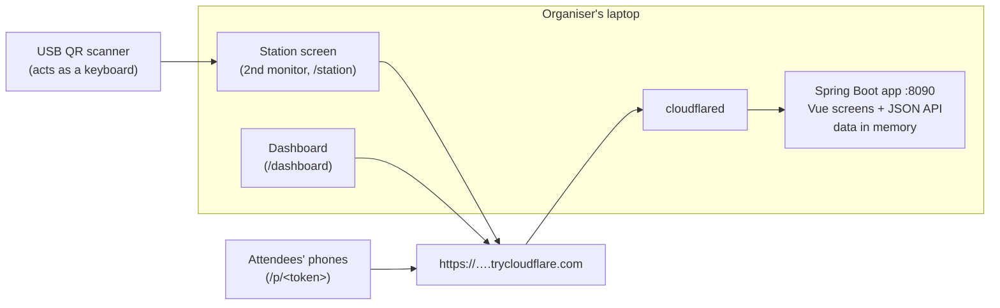
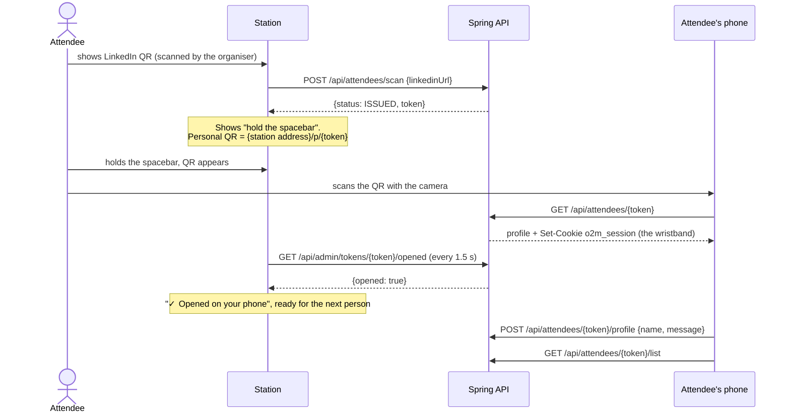
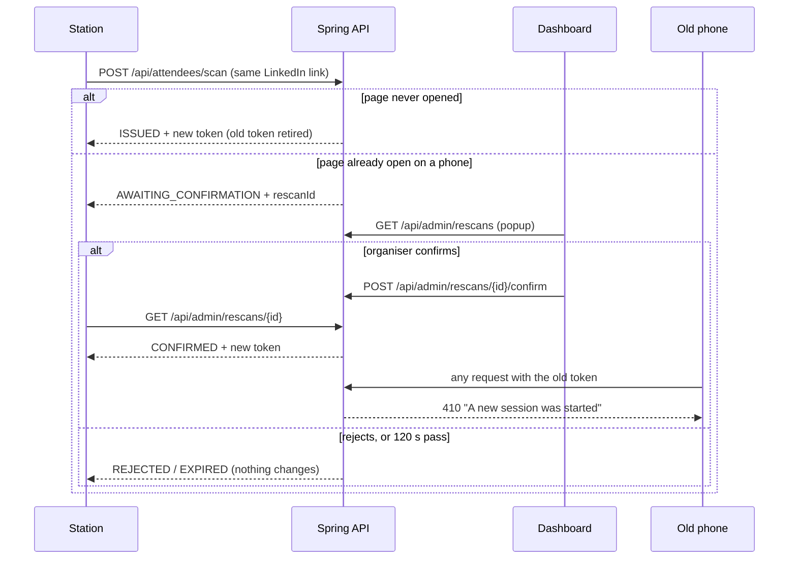
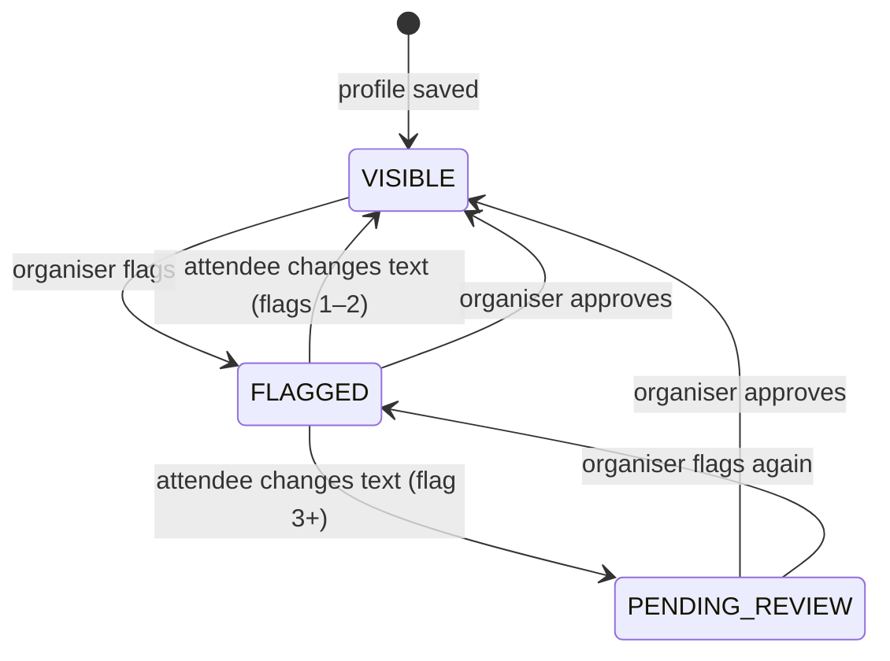

# Architecture

How One2Many works inside, and why it was built this way.

**Contents:** [The big picture](#the-big-picture) · [Main flows](#main-flows) · [Code map](#code-map) · [Design decisions](#design-decisions) · [Security model](#security-model) · [Known limits](#known-limits)

---

## The big picture

One Spring Boot application does everything: it serves the Vue app (the screens) and the JSON API, and keeps all data in memory. A Cloudflare quick tunnel gives it a public HTTPS address, so phones on any network can reach the organiser's laptop.

There are three kinds of screen, all served by the same app:

| Screen | Who | Login |
|---|---|---|
| **Station** (`/station`) | Faces the queue, on a second monitor | Staff login |
| **Dashboard** (`/dashboard`) | The organiser, on the laptop | Staff login |
| **Phone page** (`/p/<token>`) | Each attendee | None: a personal token plus a "wristband" cookie |

The screens never talk to each other directly. They all go through the API: the station and dashboard **poll** every 1.5–5 seconds, phones every 20 seconds (every 5 seconds while their card is hidden).

## Main flows

### Joining

### Re-scan (someone lost their page)

### Moderation states

Only `VISIBLE` people appear in other attendees' lists. Resubmitting the same text while flagged is refused.

## Code map

### Backend: `src/main/java/com/greg/one2many`

| Package / file | Responsibility |
|---|---|
| `service/AttendeeService` | The core. In-memory maps (`byLinkedinUrl`, `byToken`, `rescans`, `retiredTokens`); scan-in, opening a page, profile save (name lock, language filter, link check, text cleaning), public list, moderation, re-scans, releasing all sessions, LinkedIn URL normalising |
| `service/EventService` | Event details: start from `application.properties`, editable at runtime |
| `moderation/ProfanityService` | Whole-word language filter over `resources/profanity/{en,es,pt}.txt`, plus the "hidden word" hint for the dashboard |
| `web/AttendeeController` | `/api/attendees/**`: scan (staff only), page, profile, list; sets the wristband cookie |
| `web/AdminController` | `/api/admin/**`: attendees, stats, moderation actions, re-scans, event details, emergency actions |
| `web/StationController` | `/api/admin/station/**`: the manual-add "mailbox" (dashboard → station) and the station mirror |
| `web/EventController` | `GET /api/event` (public) |
| `web/SpaController` | Sends `/station`, `/dashboard`, `/about`, `/p/{token}` to the Vue app's `index.html` |
| `web/SecurityConfig` | Who may call what; pages redirect to `/login`, the API answers a plain 401 |
| `web/GlobalExceptionHandler` | Every error as translated JSON `{"error": "…"}` |
| `web/RequestSizeFilter` | 8 KB limit on API request bodies |
| `web/WebConfig` | The API always answers JSON, whatever the client asks for |
| `domain/` | `Attendee`, `Rescan` and their status enums: the internal data |
| `dto/` | What the API accepts and returns. It decides what each client can see: tokens never appear in lists |
| `exception/` | Exceptions that carry a translation key (`messages*.properties`) |

### Frontend: `frontend/src`

| File                      | Screen                                                                                                                                                         |
| ------------------------- | -------------------------------------------------------------------------------------------------------------------------------------------------------------- |
| `views/StationView.vue`   | Station: a small state machine (`idle → processing → ready ⇄ revealing → waiting / message`), scanner capture, the lock, the station mirror report             |
| `views/DashboardView.vue` | Organiser dashboard: table, moderation, re-scan popup, manual add, event form. Also recognises a scan typed into its own window and forwards it to the station |
| `views/PersonalView.vue`  | Phone page: first-visit form, then the list (search, "visited" marks kept in the phone's local storage)                                                        |
| `views/AboutView.vue`     | Public information page                                                                                                                                        |
| `api.js`                  | Small `fetch` wrapper: JSON in and out, errors as `ApiError` with the HTTP status                                                                              |

## Design decisions

### No database, on purpose
The event lasts about two hours and the privacy promise is "nothing is kept afterwards". Keeping everything in memory makes that promise true by design, and there is nothing to install or back up. The price: if the app stops, everyone is gone (see [Known limits](#known-limits)).

### Token + wristband instead of accounts
Each scan creates a random, single-use **token** (a UUID) that goes into the personal QR. The first phone to open it receives a second secret, the **wristband** cookie (`o2m_session`: HttpOnly, SameSite=Lax, Secure at the event, 12 hours, only sent to `/api/attendees`). From then on, the profile and list endpoints need both. So a photo of someone's personal QR is useless once they have opened it, and attendees never need a password.

### Hold to reveal
The personal QR is only on screen while the attendee holds the spacebar or the mouse button: at most 3 times, within 3 minutes. That makes it hard for someone in the queue to photograph another person's code. The station stays locked until the phone opens the page (detected by polling), so the next scan can't hide a code nobody has used yet.

### Re-scan needs a human
The LinkedIn QR is the only identity check, and anyone can have a screenshot of someone else's. If the person's page is already open, scanning them again does not take it over: the organiser confirms on the dashboard. If the page was never opened, there is nobody to protect, so a new code is issued straight away.

### The name is typed once
After the first save, only the organiser can change a name (to fix typos). This stops someone from switching to another person's name after others have seen their card. The sentence stays editable.

### Moderation in layers
1. **Automatic filter** on save: whole-word matching after normalising (lowercase, accents removed except `ñ`, basic leetspeak `0→o`, `4→a`…, repeated letters collapsed, punctuation to spaces). Whole words avoid false alarms like "Scunthorpe"; word-list entries shorter than 3 letters are skipped. Rejected text is not saved (422).
2. **Hidden word hint**: a swear word of 4+ letters hidden inside a longer word (`HelloM1erdaCaca`) does not block anything, but turns the row yellow on the dashboard.
3. **Links blocked** in names and sentences: the LinkedIn profile is already on the card, and a link could lead anywhere.
4. **Invisible tricks removed**: control characters, right-to-left overrides and other invisible characters are stripped; accent marks are limited to 2 per letter ("zalgo" text); emoji are kept.
5. **The organiser decides** the rest: flag, approve, rename, remove. Moderators never edit someone's sentence; they ask the person to change it. From the 3rd flag, a fix needs approval.

### One app serves everything
The Vue app is built into the jar (`gradlew bootJar` runs `npm run build` and copies `frontend/dist` into it). Spring serves the screens and the API from the same address, so cookies just work, there is no CORS setup, and the event needs one program and one tunnel.

Spring looks in `frontend/dist` on disk **before** the copy inside the jar. When the app is started from the project folder, a frontend fix can go live during the event with `npm run build`, without restarting Spring (and without losing anyone).

### Polling instead of push
Every screen asks the server for news every few seconds. With about 50 people that is a tiny load, it survives unreliable Wi-Fi, and it works through the quick tunnel without extra setup. Timeouts (re-scans, the station window) are checked when something looks at them, so there are no background timers.

### Behind the tunnel
The `event` profile (`application-event.properties`) turns on Secure cookies, trusts cloudflared's "the visitor uses HTTPS" header (`server.forward-headers-strategy=native`) and keeps redirects relative, so login never bounces to plain HTTP.

## Security model

**What it protects:** attendees' pages (only their own phone can use them), the organiser's controls (staff login), the event (nobody can flood the app or the log), and other attendees (nothing secret appears in shared lists).

| Threat                                                     | Protection                                                                                                                                                                                                                              |
| ---------------------------------------------------------- | --------------------------------------------------------------------------------------------------------------------------------------------------------------------------------------------------------------------------------------- |
| Someone photographs another person's personal QR           | Shown only while held; single-use; the wristband cookie is needed after the first open                                                                                                                                                  |
| Someone uses a screenshot of another person's LinkedIn QR  | An open page is only replaced after the organiser confirms                                                                                                                                                                              |
| A curious classmate calls the API from the browser console | Staff endpoints need the admin login (pages → `/login`, API → 401). Attendee endpoints need token + wristband. Tokens never appear in any list.                                                                                         |
| Malicious links or scripts in names and sentences          | Vue escapes all text; links are refused; only `https://…linkedin.com/in/…` and `/qr/…` URLs are accepted at scan-in                                                                                                                     |
| Cross-site requests (CSRF)                                 | Spring's CSRF tokens are off; the cookies are SameSite (staff `Strict`, wristband `Lax`). `trycloudflare.com` is on the browser [public suffix list](https://publicsuffix.org/), so another person's tunnel counts as a different site. |
| Flooding with huge requests                                | Request bodies over 8 KB are refused before they are read (413)                                                                                                                                                                         |
| Filling the log with odd requests                          | Client mistakes (405, 406, 415, unknown tokens…) are answered without writing to the log; the log is capped at 200 MB                                                                                                                   |
| Guessing the admin password                                | Must be typed at startup (never stored), at least 12 characters                                                                                                                                                                         |

The admin password lives only in an environment variable of the start-up window. It is never in the code, the config files or the log.

## Known limits

Being honest about them is part of the design:

- **One process, in memory.** If the app stops or the laptop restarts, all attendees are lost.
- **The quick tunnel address changes when the tunnel restarts.** Every phone page then stops working. The dashboard's "Release all sessions" makes everyone's next scan issue a new code without confirmations, keeping their profile.
- **Identity is only the LinkedIn QR.** Someone who arrives first with a screenshot of another person's QR can claim their name. The organiser can rename or remove them.
- **No rate limiting.** A strong admin password matters, because the login page is reachable from the internet.
- **The filters can be fooled** (spaced-out links, creative spelling). Manual moderation is the last line.
