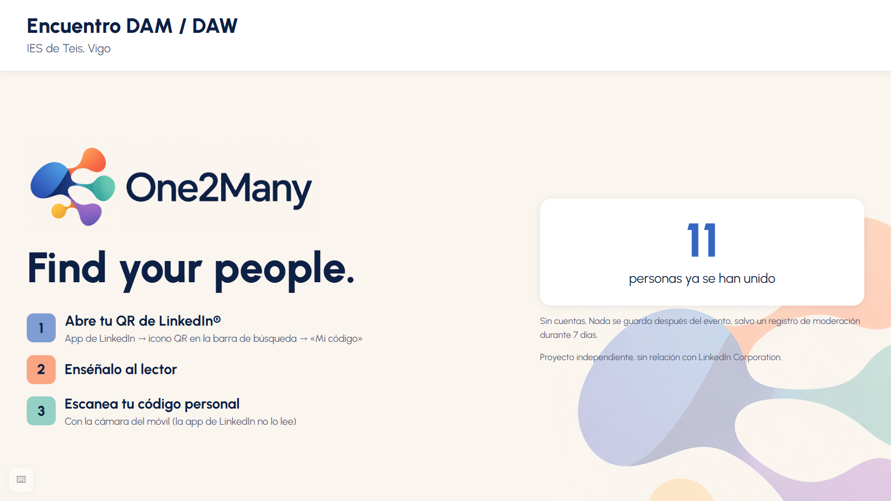
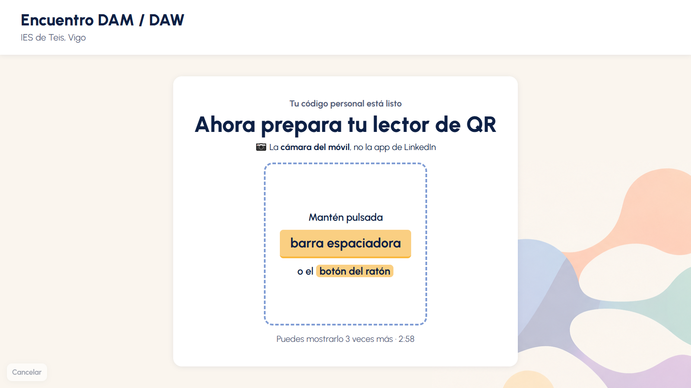
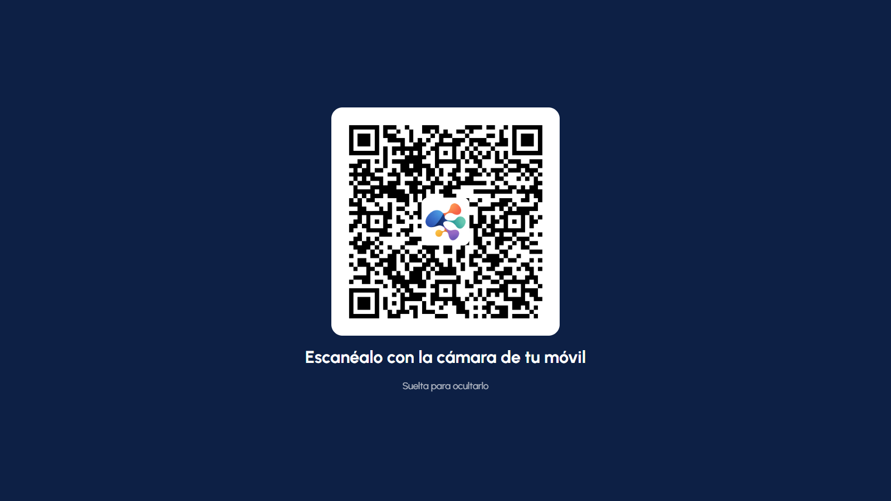
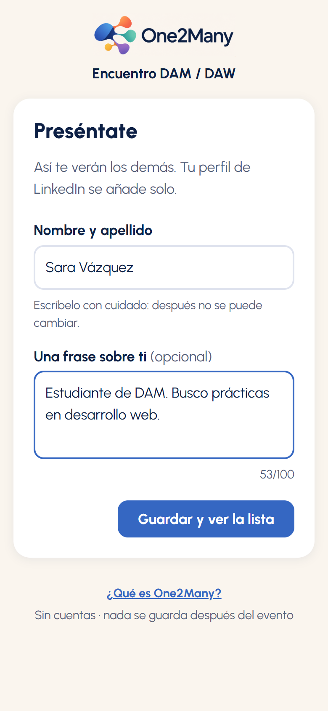
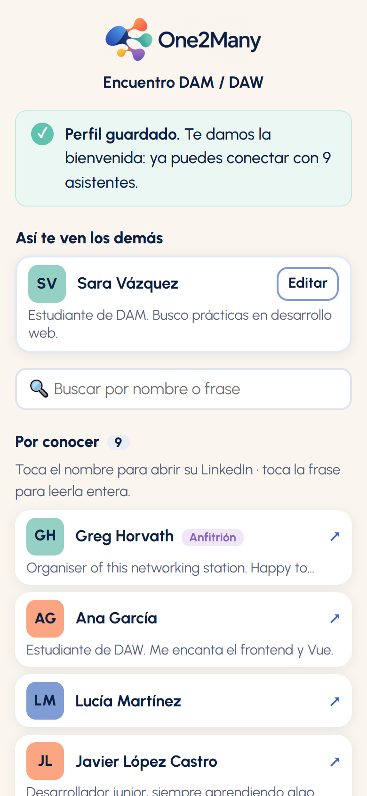
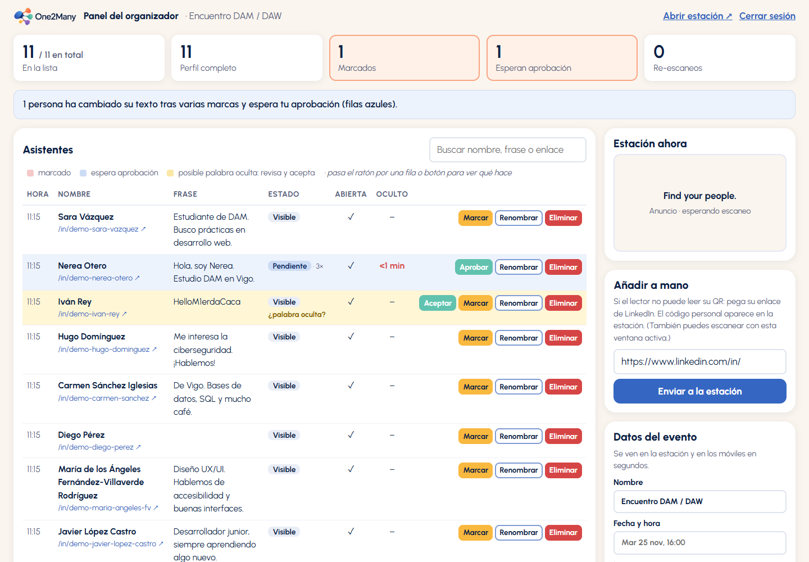
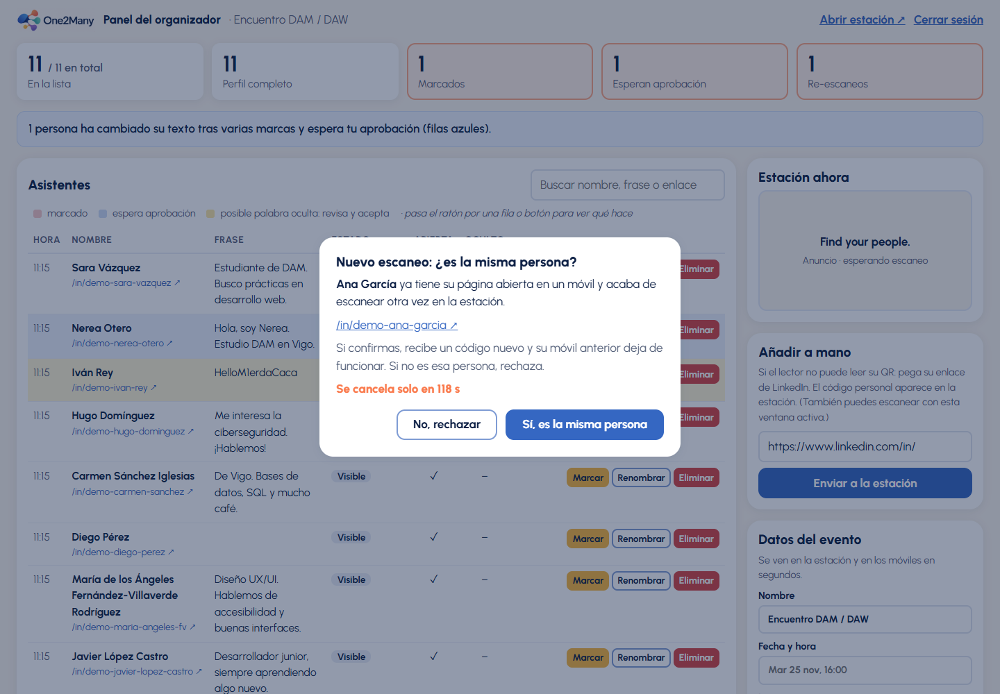

# Guía para el evento

Cómo preparar y usar One2Many en un evento. Escrita para la persona organizadora: quien tiene el lector en la mano y vigila el panel.

[English version](event-guide.md)

**Contenido:** [Qué necesitas](#qué-necesitas) · [El día antes](#el-día-antes) · [Arrancar](#arrancar-el-día-del-evento) · [Durante el evento](#durante-el-evento) · [Moderar](#moderar) · [Problemas y soluciones](#problemas-y-soluciones) · [Después del evento](#después-del-evento)

---

## Qué necesitas

| Qué | Notas |
|---|---|
| **Portátil con Windows** | Enchufado. Con Java 21 instalado. Node.js solo si vas a construir la aplicación tú. |
| **Segundo monitor** | Mirando a la cola: es la **estación**. La pantalla del portátil es tu **panel**. |
| **Lector de QR USB** | Uno que funcione como teclado y pulse Enter después de cada código. La distribución de teclado de Windows debe coincidir con la del lector (española: **ES**). |
| **Internet** | Para el túnel. Basta con wifi; la aplicación usa muy pocos datos. |
| **cloudflared** | El [programa de túneles de Cloudflare](https://developers.cloudflare.com/cloudflare-one/connections/connect-networks/downloads/), gratuito. Da a la aplicación una dirección pública `https://….trycloudflare.com` que los móviles pueden abrir. No hace falta cuenta. |
| **Una contraseña de administrador** | Mínimo 12 caracteres y que no empiece por `{`. Cuanto más larga y aleatoria, mejor: la página de acceso se puede abrir desde internet. |

## El día antes

1. **Pon los datos del evento y la tarjeta del anfitrión.** En `src/main/resources/application.properties`:
   - `one2many.event.*`: nombre, fecha, lugar, organizadores y descripción. También se pueden cambiar después desde el panel.
   - `one2many.host.*`: el nombre del organizador, su enlace de LinkedIn y una frase. Esta tarjeta aparece fija arriba en la lista de cada asistente.
2. **Construye la aplicación.** En un terminal, en la carpeta del proyecto: `gradlew.bat bootJar`. Se crea `build\libs\one2many.jar`, con el frontend dentro.
3. **Haz una prueba completa** con `start-event.bat`, un segundo monitor y un móvil de verdad. Escanéate, abre tu página en el móvil y luego pulsa Ctrl+C en las dos ventanas.
4. **Evita que el portátil se suspenda.** La suspensión corta el túnel. En un terminal: `powercfg /change standby-timeout-ac 0`. En las opciones de energía de Windows, pon «Al cerrar la tapa» (enchufado) en **No hacer nada**.
5. **Desactiva la edición rápida en las ventanas de consola.** Con la edición rápida activada, un solo clic dentro de la ventana pausa la aplicación. En la ventana: clic derecho en la barra de título → *Propiedades* → desmarca **Modo de edición rápida**. Hazlo en la ventana de la aplicación y en la del túnel.

## Arrancar el día del evento

1. Haz doble clic en **`start-event.bat`**, en la carpeta del proyecto.
2. Escribe la contraseña de administrador (no se ve mientras escribes). Solo existe en esa ventana; nunca se guarda.
3. Se abre una segunda ventana: el **túnel**. Al cabo de unos segundos muestra una dirección como `https://algo-aleatorio.trycloudflare.com`. Si el Firewall de Windows pregunta por `cloudflared.exe`, elige **Cancelar**: el túnel solo hace conexiones de salida.
4. Abre **esa dirección** (no `localhost`) en dos ventanas del navegador e inicia sesión como `admin` en cada una:
   - en el **segundo monitor**: ve a `/station` y pulsa **F11** para pantalla completa;
   - en el **portátil**: al iniciar sesión llegas al **panel**.

> Los códigos personales se crean con la dirección en la que está abierta la estación. Si la estación está en `localhost`, muestra un aviso rojo y los móviles no pueden abrir los códigos.

> **Inicia sesión con calma.** Varias contraseñas incorrectas a través del túnel también pausan *tus* inicios de sesión por el túnel durante unos minutos. Deja los dos navegadores abiertos cuando hayas entrado: una sesión abierta nunca se ve afectada.
>
> **Puerta de emergencia:** en el propio portátil, `http://127.0.0.1:8090/dashboard` siempre te deja entrar, incluso durante una pausa (`start-event.bat` la muestra). Nadie más puede usar esta puerta: la aplicación solo acepta conexiones directas desde el propio portátil. Pero la estación debe seguir en la dirección del túnel: «Abrir estación ↗» desde un panel en `127.0.0.1` abre la estación también ahí (aviso rojo, los móviles no pueden abrir los códigos).

## Durante el evento

### Qué pasa con cada persona

1. La persona abre la app de LinkedIn → el icono QR de la barra de búsqueda → *Mi código*, y te lo enseña.
2. Lo escaneas. La estación muestra **«Tu código personal está listo»**.

   

3. La persona **mantiene pulsada la barra espaciadora** (o el botón del ratón). Su código personal solo se ve mientras la mantiene pulsada.

   

4. Lo escanea con la **cámara del móvil**. El lector de la app de LinkedIn rechaza los códigos que no son de LinkedIn, así que dilo en voz alta: *«con la cámara del móvil»*.
5. En cuanto su móvil abre la página, la estación muestra una confirmación y queda lista para la siguiente persona.

En el móvil escribe su nombre (una sola vez: después no se puede cambiar) y una frase opcional, y ve a todos los demás.

| Primera visita | La lista |
|---|---|
|  |  |

### El bloqueo de la estación

Mientras un código personal espera a que lo abran, la estación no acepta otro escaneo. Se libera sola cuando:
- el móvil abre la página, o
- el código se ha mostrado 3 veces, o
- han pasado 3 minutos, o
- pulsas **Cancelar** (abajo a la izquierda en la estación).

Si escaneas durante el bloqueo, aparece abajo en la estación una pequeña nota roja para ti.

### Si el lector no puede leer un móvil

En el panel, en **Añadir a mano**, pega el enlace de LinkedIn de la persona y pulsa **Enviar a la estación**. La estación muestra su código como si la hubieras escaneado. En la propia estación también hay un pequeño botón de teclado (abajo a la izquierda) para escribir un enlace.

Si escaneas sin querer con la ventana del **panel** activa, el panel lo detecta y envía el escaneo a la estación por ti.

## Moderar

El panel se actualiza cada pocos segundos. Pasa el ratón por encima de cualquier fila o botón para ver qué hace.

| Color de la fila | Qué significa | Qué hacer |
|---|---|---|
| ninguno | Visible para todos | Nada |
| **rojo** | **Marcado**: oculto para los demás; la persona ve un aviso naranja que le pide cambiar su texto | Esperar a que lo corrija. Las correcciones tras la 1.ª y la 2.ª marca aparecen solas. |
| **azul** | **Pendiente**: ha cambiado su texto después de la 3.ª marca | Léelo: **Aprobar** si está bien, **Marcar** otra vez si no |
| **amarillo** | Posible palabrota escondida dentro de otra palabra (p. ej. `HelloM1erdaCaca`), o un nombre sobre el que avisó el móvil y que la persona guardó igualmente | **Aceptar** si está bien, **Marcar** si no |

Botones de cada fila:
- **Marcar**: oculta la tarjeta de la persona y le pide que cambie su texto.
- **Renombrar**: corrige una errata en un nombre. Los asistentes no pueden cambiar su propio nombre después de guardarlo.
- **Eliminar**: quita a la persona (dos clics para confirmar).

¿Lleva oculta más de 10 minutos? La fila pasa a una sección aparte al final de la tabla.

### Confirmar un nuevo escaneo

Si se vuelve a escanear a alguien cuya página ya está abierta en un móvil (perdió el móvil, cerró el navegador…), aparece un aviso que pregunta si es la misma persona. También podría ser alguien con una foto de su QR de LinkedIn.

- **Sí, es la misma persona**: recibe un código nuevo en la estación, y la página antigua deja de funcionar.
- **No, rechazar**, o sin respuesta en 2 minutos: no cambia nada.

### Otras herramientas del panel

- **Datos del evento**: cambia el nombre, la fecha, el lugar, los organizadores y la descripción cuando quieras. La estación y los móviles se actualizan en segundos. Al reiniciar, vuelven los valores de `application.properties`.
- **Estación ahora**: una mini copia en directo de lo que muestra la estación (nunca el código personal).
- **Liberar todas las sesiones** (Emergencia): mira [Problemas y soluciones](#problemas-y-soluciones).
- **Vaciar lista** (Nuevo evento): borra a todos los asistentes. No se puede deshacer.
- **Banner rojo «intentos fallidos de inicio de sesión desde fuera»**: alguien está intentando adivinar la contraseña de administrador a través del túnel. Tu sesión está a salvo. Tras unos pocos intentos fallidos, los nuevos inicios de sesión desde fuera se pausan un rato, así que adivinarla es imposible en la práctica. El banner es rojo mientras dura una pausa o si el último fallo fue reciente; después pasa a ser una línea gris discreta (así un despiste tuyo no grita todo el evento).

## Problemas y soluciones

| Problema | Causa | Solución |
|---|---|---|
| El lector escribe `https;--www…` u otros caracteres raros | La distribución de teclado de Windows no coincide con la del lector | Cambia Windows a la distribución **ES** (Win + Espacio). La nota roja de la estación muestra lo que se ha leído («Leído: …»). |
| Escanear no hace nada | La ventana de la estación no está activa, o la estación está bloqueada | Haz un clic en la estación. Mira la nota roja de abajo. Pulsa **Cancelar** si la persona anterior se fue. |
| «Lectura incompleta» | El escaneo llegó demasiado lento | Vuelve a escanear. |
| Aviso rojo sobre `localhost` en la estación | La estación se abrió en `localhost` | Abre la dirección del túnel. |
| Un móvil muestra **«Este código ya se ha usado»** | El código se abrió antes en otro móvil o navegador, o la persona lo escaneó con una app que usa su propio navegador | Vuelve a escanear a la persona en la estación y confírmalo en el panel. |
| Un móvil muestra **«Esta página es de otro móvil»** | La página se usa en otro navegador distinto al de la primera vez | Ábrela en el primer navegador, o vuelve a escanear. |
| Un móvil muestra **«Se ha iniciado una nueva sesión»** | Se confirmó un nuevo escaneo | Normal: su página nueva es la del código nuevo. |
| Banner amarillo de inicio de sesión en la estación o el panel | La sesión de organizador caducó | Haz clic en el banner y vuelve a iniciar sesión. |
| La ventana del túnel se cerró o muestra una **dirección nueva** | El túnel se reinició. Las páginas de los móviles usan la dirección antigua y dejan de funcionar | Abre la estación y el panel en la dirección nueva. En el panel pulsa **Liberar todas las sesiones** (dos veces). Todos vuelven a escanear: sin confirmaciones, y se conservan su nombre y su frase. |
| La ventana de la aplicación se cerró o el portátil se reinició | **Se pierden todos los asistentes** (solo existen en memoria) | Vuelve a arrancar con `start-event.bat`. Todos tienen que volver a escanear y escribir su perfil. |
| La aplicación parece congelada | Edición rápida: alguien hizo clic en la ventana de consola | Pulsa **Esc** en esa ventana. Desactiva la edición rápida. |
| `start-event.bat` dice que el puerto 8090 está ocupado | La aplicación ya está abierta en otra ventana | Cierra primero la otra ventana, o usa esa. |
| **Inicio de sesión en pausa**: siempre dice que la contraseña es incorrecta, o el panel muestra «Inicios de sesión en pausa» | Varias contraseñas incorrectas desde fuera: los nuevos inicios de sesión por el túnel se pausan unos minutos (incluso con la contraseña correcta) | Espera la hora indicada, o inicia sesión en el portátil en `http://127.0.0.1:8090/dashboard`. Las sesiones ya abiertas siguen funcionando. |

## Después del evento

1. Pulsa **Ctrl+C** en la ventana de la aplicación y en la del túnel. Todos los datos de los asistentes desaparecen al parar la aplicación.
2. Borra la carpeta **`logs`** de la carpeta del proyecto. Contiene el registro de moderación (solo avisos: marcas, aprobaciones, eliminaciones), que incluye nombres. Se guarda como mucho 7 días, pero bórrala tú después del evento para cumplir la promesa de privacidad.
