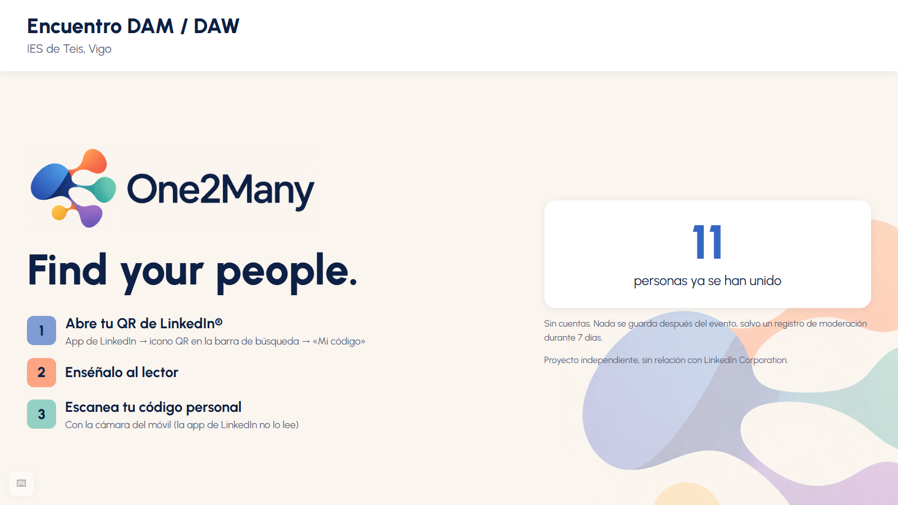
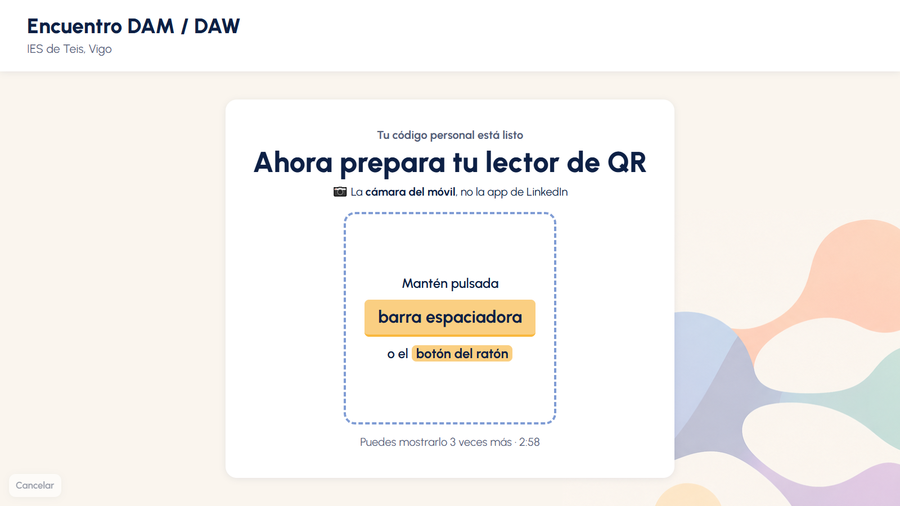
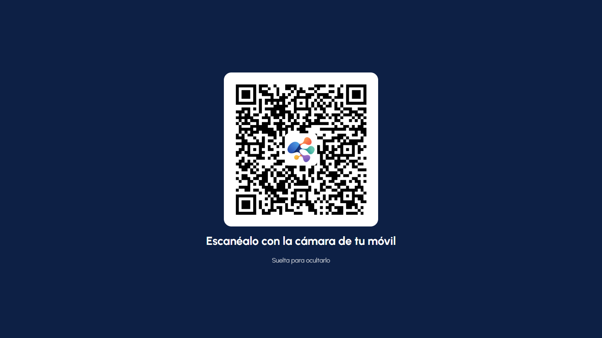
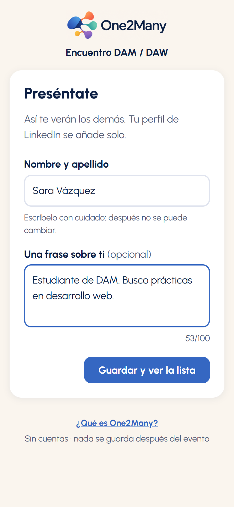
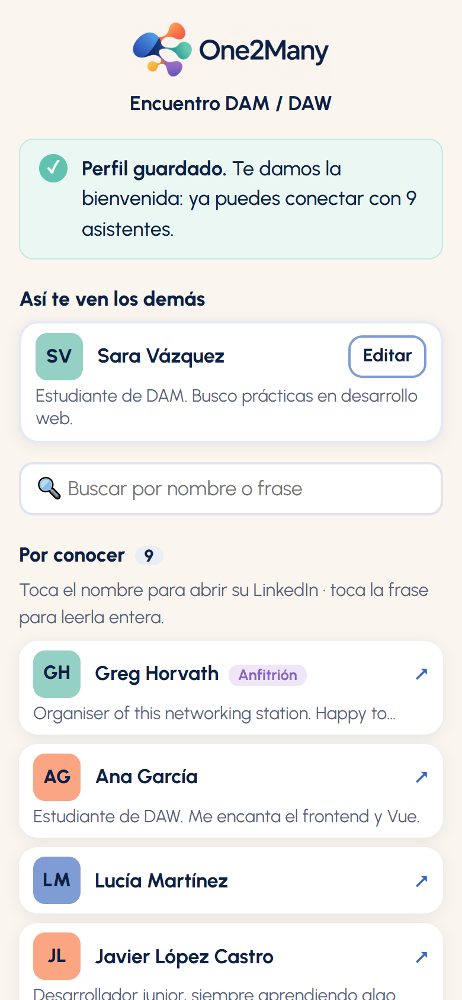
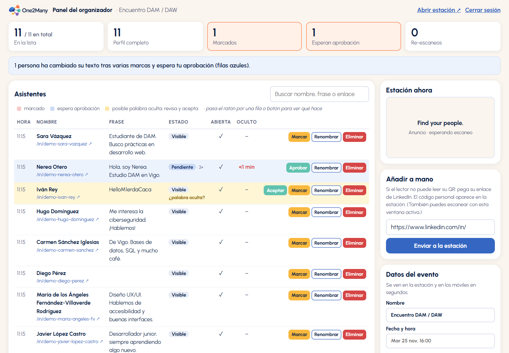
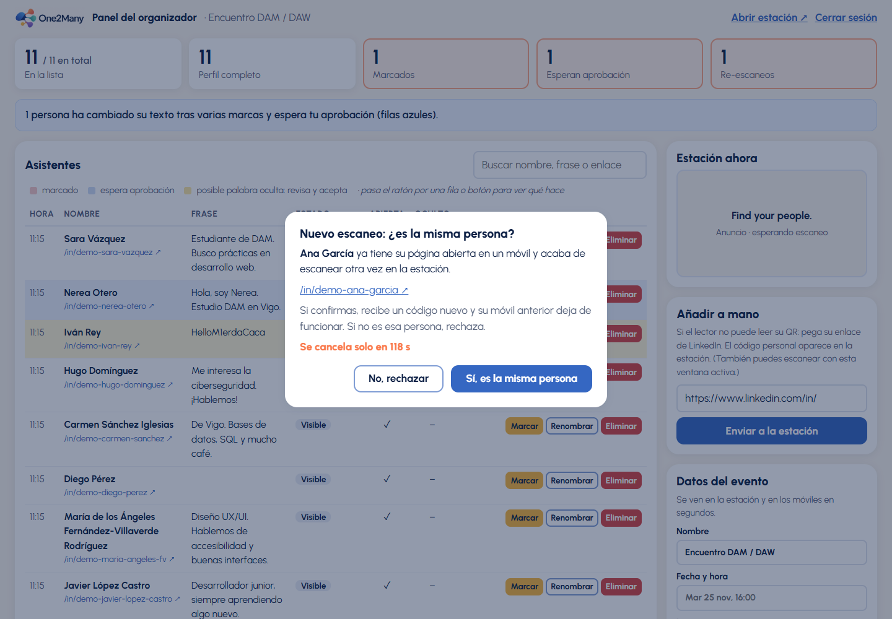

# Event guide

How to prepare and run One2Many at an event. Written for the organiser: the person holding the scanner and watching the dashboard.

[Versión en español](event-guide.es.md)

**Contents:** [What you need](#what-you-need) · [The day before](#the-day-before) · [Starting](#starting-on-the-day) · [During the event](#during-the-event) · [Moderating](#moderating) · [Troubleshooting](#troubleshooting) · [After the event](#after-the-event)

---

## What you need

| Item | Notes |
|---|---|
| **Windows laptop** | Plugged in. Java 21 installed. Node.js only if you build the app yourself. |
| **Second monitor** | Facing the queue: this is the **station**. The laptop screen is your **dashboard**. |
| **USB QR scanner** | One that works as a keyboard and presses Enter after each code. Windows keyboard layout must match it (Spanish layout: **ES**). |
| **Internet** | For the tunnel. Wi-Fi is enough; the app itself uses very little data. |
| **cloudflared** | Free [Cloudflare tunnel program](https://developers.cloudflare.com/cloudflare-one/connections/connect-networks/downloads/). It gives the app a public `https://….trycloudflare.com` address that phones can open. No account needed. |
| **An admin password** | At least 12 characters, not starting with `{`. Longer and random is better: the login page is reachable from the internet. |

## The day before

1. **Set the event details and the host card.** In `src/main/resources/application.properties`:
   - `one2many.event.*`: name, date, place, organisers, description. You can also change these later on the dashboard.
   - `one2many.host.*`: the organiser's name, LinkedIn link and a sentence. This card is pinned at the top of every attendee's list.
2. **Build the app.** In a terminal, in the project folder: `gradlew.bat bootJar`. This creates `build\libs\one2many.jar` with the frontend inside.
3. **Do a full test run** with `start-event.bat`, a second monitor and a real phone. Scan yourself, open your page on the phone, then press Ctrl+C in both windows.
4. **Stop the laptop from sleeping.** Sleep drops the tunnel. In a terminal: `powercfg /change standby-timeout-ac 0`. In Windows power settings, set "When I close the lid" (plugged in) to **Do nothing**.
5. **Turn off QuickEdit in the console windows.** If QuickEdit is on, a single click inside the window pauses the app. Open the window → right-click the title bar → *Properties* → untick **QuickEdit Mode**. Do it for the app window and the tunnel window.

## Starting on the day

1. Double-click **`start-event.bat`** in the project folder.
2. Type the admin password (hidden while you type). It only lives in that window; it is never saved.
3. A second window opens: the **tunnel**. After a few seconds it shows an address like `https://something-random.trycloudflare.com`. If Windows Firewall asks about `cloudflared.exe`, choose **Cancel**: the tunnel only makes outgoing connections.
4. Open **that address** (not `localhost`) in two browser windows and log in as `admin` in each one:
   - on the **second monitor**: go to `/station` and press **F11** for full screen;
   - on the **laptop**: you land on the **dashboard** after logging in.

> The personal codes are built from the address the station is open on. If the station is on `localhost`, it shows a red warning and phones cannot open the codes.

> **Log in calmly.** Several wrong passwords through the tunnel also pause *your* tunnel logins for a few minutes. Keep both browsers open once you are in: a running session is never affected.
>
> **Emergency door:** on the laptop itself, `http://127.0.0.1:8090/dashboard` always lets you log in, even during a pause (`start-event.bat` prints it). Nobody else can use this door: the app only accepts direct connections from the laptop itself. But the station must stay on the tunnel address: "Abrir estación ↗" from a `127.0.0.1` dashboard opens the station there too (red warning, phones can't open the codes).

## During the event

### What happens with each person

1. The attendee opens the LinkedIn app → the QR icon in the search bar → *My code*, and shows it to you.
2. You scan it. The station shows **"Tu código personal está listo"**.

   

3. The attendee **holds the spacebar** (or the mouse button). Their personal code appears only while it is held.

   

4. They scan it with the **phone camera**. The LinkedIn app's scanner refuses codes that are not from LinkedIn, so say it out loud: *"con la cámara del móvil"*.
5. As soon as their phone opens the page, the station shows a confirmation and is ready for the next person.

On the phone they write a name (only once: it cannot be changed later) and an optional sentence, then see everyone else.

| First visit | The list |
|---|---|
|  |  |

### The station lock

While a personal code is waiting to be opened, the station does not accept a new scan. It frees itself when:
- the phone opens the page, or
- the code was shown 3 times, or
- 3 minutes have passed, or
- you press **Cancelar** (bottom left of the station).

If you scan during the lock, a small red note for you appears at the bottom of the station.

### If the scanner cannot read a phone

On the dashboard, under **Añadir a mano**, paste the person's LinkedIn link and press **Enviar a la estación**. The station then shows their code as if they had been scanned. On the station itself there is also a small keyboard button (bottom left) for typing a link.

If you accidentally scan while the **dashboard** window is active, the dashboard notices and sends the scan to the station for you.

## Moderating

The dashboard updates every few seconds. Hover over any row or button to see what it does.

| Row colour | Meaning | What to do |
|---|---|---|
| none | Visible to everyone | Nothing |
| **red** | **Marcado** (flagged): hidden from the others; the person sees an orange notice asking them to change their text | Wait for them to fix it. Fixes after the 1st and 2nd flag appear automatically. |
| **blue** | **Pendiente**: changed their text after the 3rd flag | Read it: **Aprobar** if it is fine, **Marcar** again if not |
| **yellow** | A possible swear word hidden inside another word (e.g. `HelloM1erdaCaca`), or a name the phone warned about that the person saved anyway | **Aceptar** if it is fine, **Marcar** if not |

Buttons on each row:
- **Marcar**: hide the person's card and ask them to change their text.
- **Renombrar**: fix a typo in a name. Attendees cannot change their own name after saving it.
- **Eliminar**: remove the person (click twice to confirm).

Hidden for more than 10 minutes? The row moves to a separate section at the bottom of the table.

### Re-scan confirmation

If someone whose page is already open on a phone is scanned again (lost phone, closed browser…), a popup asks whether it is the same person. It could also be someone with a photo of their LinkedIn QR.

- **Sí, es la misma persona**: they get a new code at the station, and the old page stops working.
- **No, rechazar**, or no answer within 2 minutes: nothing changes.

### Other tools on the dashboard

- **Datos del evento**: change the event name, date, place, organisers and description at any time. Station and phones update within seconds. A restart brings back the values from `application.properties`.
- **Estación ahora**: a live mini-copy of what the station shows (never the personal code).
- **Liberar todas las sesiones** (Emergencia): see [Troubleshooting](#troubleshooting).
- **Vaciar lista** (Nuevo evento): deletes all attendees. Cannot be undone. Phones that still have their page open then show "El evento ha terminado. Gracias por usar One2Many. ¡Nos vemos en el próximo!" instead of an error.
- **Red banner "intentos fallidos de inicio de sesión desde fuera"**: someone is guessing the admin password through the tunnel. Your session is safe. After a few wrong tries, new outside logins pause for a while, which makes guessing hopeless. The banner is red while a pause runs or the last failure was recent; after that it becomes a quiet grey line (so one typo of yours doesn't shout all event).

## Troubleshooting

| Problem | Cause | Fix |
|---|---|---|
| The scanner types `https;--www…` or other garbage | Windows keyboard layout does not match the scanner | Switch Windows to the **ES** layout (Win + Space). The station's red note shows what was read ("Leído: …"). |
| Scanning does nothing | The station window is not active, or the station is locked | Click once on the station. Check the red note at the bottom. Press **Cancelar** if the previous person left. |
| "Lectura incompleta" | The scan arrived too slowly | Scan again. |
| Red warning about `localhost` on the station | The station was opened on `localhost` | Open the tunnel address instead. |
| A phone shows **"Este código ya se ha usado"** | The code was opened on another phone or browser first, or the person scanned it with an app that keeps its own browser | Scan the person again at the station and confirm on the dashboard. |
| A phone shows **"Esta página es de otro móvil"** | The page is used in a different browser than the first time | Open it in the first browser, or re-scan. |
| A phone shows **"Se ha iniciado una nueva sesión"** | A re-scan was confirmed | Normal: their new page is the one from the new code. |
| Yellow login banner on the station or dashboard | The staff login expired | Click the banner and log in again. |
| The tunnel window closed or shows a **new address** | The tunnel restarted. Every phone page uses the old address and stops working | Open the station and dashboard on the new address. On the dashboard press **Liberar todas las sesiones** (twice). Everyone re-scans: no confirmations needed, and their name and sentence are kept. |
| The app window closed or the laptop restarted | **All attendees are lost** (they only live in memory) | Start again with `start-event.bat`. Everyone has to re-scan and write their profile again. |
| The app seems frozen | QuickEdit: someone clicked in the console window | Press **Esc** in that window. Turn QuickEdit off. |
| `start-event.bat` says port 8090 is busy | The app is already running in another window | Close the other window first, or use it. |
| Login keeps saying the password is wrong, or the dashboard shows **"Inicios de sesión en pausa"** | Repeated wrong passwords from outside: new tunnel logins are paused for a few minutes (even the right password is refused) | Wait for the time shown, or log in on the laptop at `http://127.0.0.1:8090/dashboard`. Sessions that are already open keep working. |

## After the event

1. Press **Ctrl+C** in the app window and in the tunnel window. All attendee data disappears when the app stops.
2. Delete the **`logs`** folder in the project folder. It holds the moderation log (warnings only: flags, approvals, removals), which includes names. It is kept at most 7 days, but delete it yourself after the event to keep the privacy promise.
