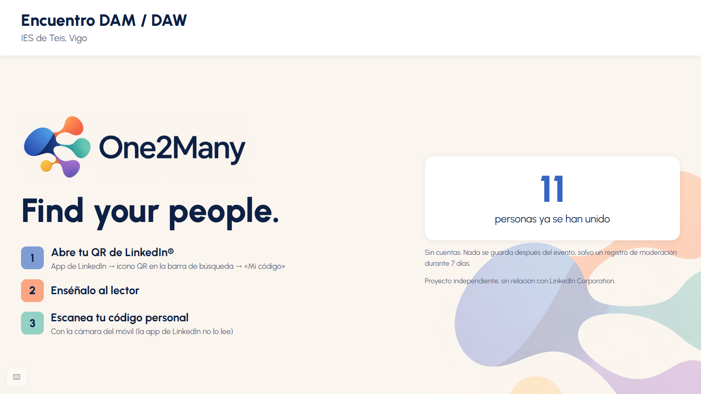
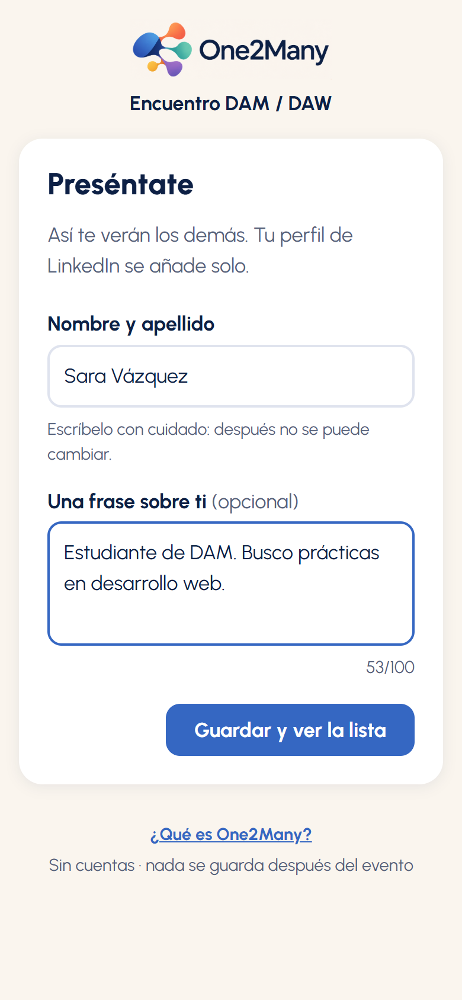
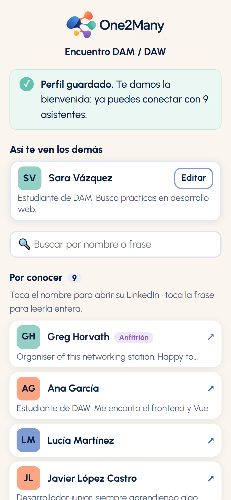
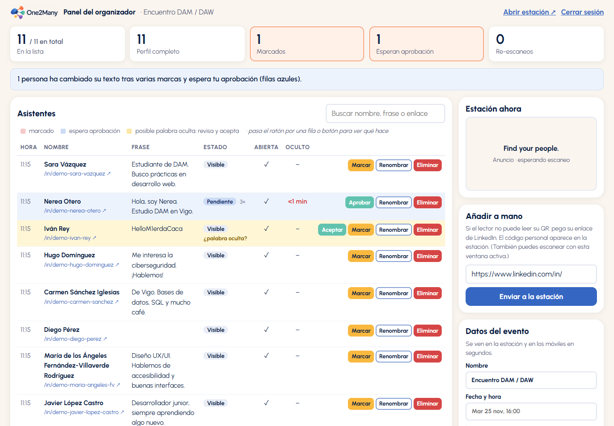

# One2Many

**Find your people.** A self-service LinkedIn networking station for events.

Attendees show their LinkedIn QR code at a station, scan a personal code with their phone, write their name and one sentence about themselves, and see everyone else who has joined. They can then connect on LinkedIn at their own pace. No accounts, no app to install, and nothing is kept after the event.



## How it works

| 1. Show your LinkedIn QR                                                                                                                                                                                | 2. Scan your personal code                                                                                       | 3. Meet everyone                                                                                              |
| ------------------------------------------------------------------------------------------------------------------------------------------------------------------------------------------------------- | ---------------------------------------------------------------------------------------------------------------- | ------------------------------------------------------------------------------------------------------------- |
| The organiser scans the attendee's LinkedIn QR with a USB reader (Or enters the link manualy). The station prepares a personal code, shown only while the attendee holds the spacebar/left mouse click. | The attendee scans it with the phone camera. Their own page opens, and from then on it only works on that phone. | They write a name and a sentence and get a list of everyone else, each with a link to their LinkedIn profile. |
|                                                                                                                                 |                                                           |                                                  |

The organiser follows everything on a dashboard: who has joined, moderation, re-scan confirmations and the event details.



## Features

- **Station screen** for a second monitor: works with a USB QR scanner (it acts like a keyboard), and shows the personal code only while it is held down: at most 3 times, within 3 minutes.
- **Personal page on the phone**, protected by a "wristband" cookie: a photo of someone's code is useless once they have opened it.
- **Moderation**: automatic language filter (English, Spanish, Portuguese word lists), links blocked, flag / approve / rename / remove on the dashboard, and a hint for swear words hidden inside other words.
- **Re-scan with confirmation**: someone who lost their page can scan again, and the organiser confirms it is really them.
- **Login protection**: repeated wrong admin passwords from outside pause new logins for a few minutes, with a warning on the dashboard.
- **Privacy first**: no database. Everything lives in memory during the event; only a short moderation log is kept, for 7 days.
- **Runs on one laptop**: one `.jar` file plus a free Cloudflare tunnel for HTTPS. No server or hosting needed.
- **Interface in Spanish**; error messages in English, Spanish and Galician.

## Try it locally

You need **Java 21** and **Node.js 22.18+** (Node is only needed to build the frontend).

```bash
# in the project folder
./gradlew bootJar                    # Windows: gradlew.bat bootJar
java -jar build/libs/one2many.jar
```

- Open `http://localhost:8080` and log in as `admin`. The password is printed in the console at startup ("Using generated security password").
- To fill the app with fake attendees (Windows): `powershell -ExecutionPolicy Bypass -File scripts\demo-data.ps1`

Running it at a real event (HTTPS tunnel, event settings, a fixed password) is explained in the [event guide](docs/event-guide.md).

## Documentation

| Document | For whom |
|---|---|
| [Event guide](docs/event-guide.md) · [en español](docs/event-guide.es.md) | Organisers: preparing, running the day, troubleshooting |
| [Architecture](docs/architecture.md) | How it works inside, and why it was built this way |
| [API reference](docs/api.md) | Every endpoint and status code |
| [Development](docs/development.md) | Running it in development mode, tests, conventions |
| [Security](SECURITY.md) | How to report a weakness privately |

## Built with

Java 21 · Spring Boot 4 · Spring Security · Vue 3 · Vite · Gradle. 341 automated tests: 250 for the backend (JUnit 5 + MockMvc) and 91 for the frontend logic (Vitest).

## Credits

- Word lists: [List of Dirty, Naughty, Obscene, and Otherwise Bad Words](https://github.com/LDNOOBW/List-of-Dirty-Naughty-Obscene-and-Otherwise-Bad-Words) (CC BY 4.0). The Spanish list was extended by hand.
- [AllProfanity](https://www.npmjs.com/package/allprofanity) for the instant language hint on the phone, and [qrcode](https://www.npmjs.com/package/qrcode) for the personal codes.
- Font: [Urbanist](https://fonts.google.com/specimen/Urbanist).

One2Many is an independent project, not affiliated with LinkedIn Corporation. LinkedIn is a trademark of LinkedIn Corporation.

## About

One2Many was created by **Gergely (Greg) Horvath**, a web application development (DAW) student in Vigo, Spain. It is my first complete application, built for a networking event at my school. Feedback is welcome: [LinkedIn](https://www.linkedin.com/in/gergely-horvath-p5tyos).

The name is a nod to JPA's `@OneToMany` relationship: one person, many connections.

## License

Licensed under the [Apache License 2.0](LICENSE): you are welcome to use, change and share One2Many, including at your own events. If you share a changed version, keep the [NOTICE](NOTICE) file, mark the files you changed, and don't present it as the original One2Many. Improvements are welcome as pull requests.
